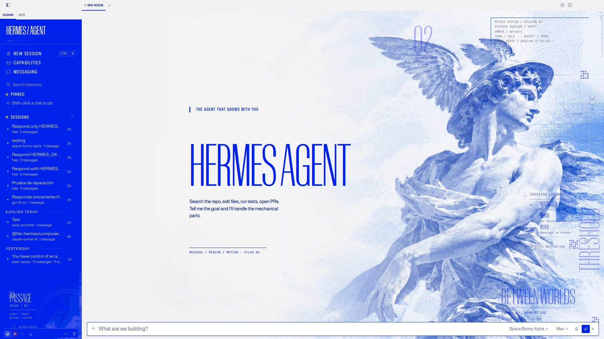

# 🛠️ start-hermes / automation script with PowerShell

One-command launcher for a private, self-hosted [Hermes Agent](https://github.com/NousResearch/hermes-agent)
on Windows, using a local model through LM Studio.

**What it does**
1. Starts Docker Desktop if it is not running
2. Starts the LM Studio server and loads the model
3. Creates the persistent Docker volume `hermes-data`
4. Creates or starts the Hermes container (gateway + dashboard)
5. Waits for the dashboard and opens it in the browser

**Setup:** run the Hermes setup wizard once, then create
`hermes_dashboard.env` (dashboard login, never commit it) next to the script.

# 💡 Case Study
juliusaalto.com - [Case Study Hermes](https://juliusaalto.com/projects/hermes-agent-portfolio)

